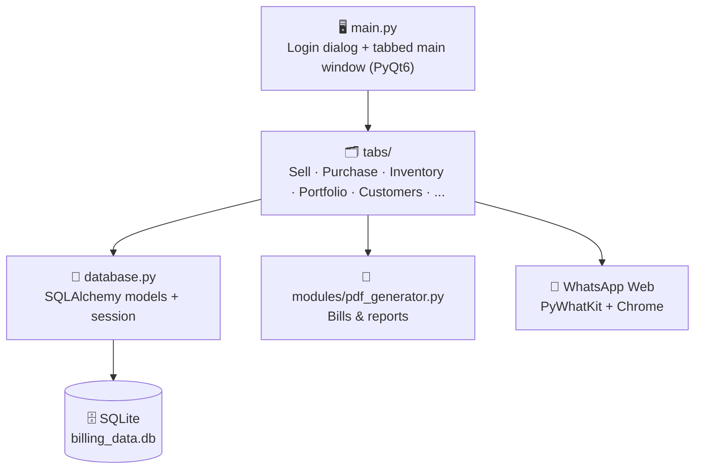

<div align="center">

# 🧾 Billing System — Desktop Billing Software for Small Businesses

**Two Python desktop billing applications in one repo: one for a car garage / service centre and one for a convenience store. Built with PyQt6 and SQLite.**


[Overview](#-overview) • [The Two Apps](#-the-two-apps) • [Features](#-features) • [Tech Stack](#-tech-stack) • [Getting Started](#-getting-started) • [Installers](#-windows-installers) • [Database](#-database) • [Android App](#-android-version)

</div>

---

## 📋 Overview

This repository holds two complete billing systems that I built for real small-business use. Both share the same architecture: a tabbed **PyQt6** desktop interface, a local **SQLite** database through **SQLAlchemy**, **PDF bills and reports** with ReportLab, and **WhatsApp bill sharing**.

| | 🚗 [Garage](./Garage) | 🏪 [Convenience](./Convenience) |
|---|---|---|
| **Built for** | Car garage / service centre | Convenience / retail store |
| **Bill captures** | Customer, mobile, **car model, car number, KM reading** | Optional customer name and mobile, **cash received** |
| **Item entry** | Free-text items with auto-suggest | Product picked from inventory |
| **Special features** | **Next-service reminders**, tracked-item purchases, multi-car customers | **Per-product profit analytics**, stock management |
| **Windows installer** | v3.0 | v1.0 |

> 📱 A **native Android version** of the garage system lives in a separate repo: [**BillingSystem_App**](https://github.com/IshanPatel1912/BillingSystem_App).

---

## 🚗 The Two Apps

### Garage Billing System — `Garage/`

Made for a workshop where every bill belongs to a customer **and a car**.

| Tab | What it does |
|---|---|
| 💰 **Sell** | Create a bill with customer, mobile, car model / number / KM; add items with quantity and rate; apply a discount %; mark as paid; **send the bill on WhatsApp**; tick **Next Service Reminder** to schedule the next service |
| 🛒 **Gen. Purchase** | Record general purchases with categories |
| 📋 **Tracked Items Purchase** | Record purchases of items you want to monitor |
| 💸 **Expenditure** | Log daily expenses with a running serial number |
| 🕰️ **Purchase History** | Browse and manage past purchases |
| 🔍 **Find Bill** | Search, view, edit and delete bills |
| 📦 **Inventory** | Items with quantity, cost price and MRP |
| 📊 **Portfolio** | Sales, purchases, expenses and **net profit** for Today / This Month / This Year / All Time / a custom date; CSV and PDF reports |
| 🏠 **Dashboard** | Daily stats with that day's itemized purchases and expenses |
| 👥 **Customers** | Customer profiles with **multiple cars each**; export the list as PDF |
| ⚙️ **Settings** | Business name, address, phone, owner and logo |

### Convenience Store Billing System — `Convenience/`

Made for a counter-sale shop with stock to manage.

| Tab | What it does |
|---|---|
| 💰 **POS / Sell** | Fast billing by picking products, with optional customer details, discount, cash-received input, paid status and WhatsApp sending |
| 🛒 **Purchase** | Record stock purchases with cost price and MRP |
| 💸 **Expenditure** | Log business expenses |
| 🔍 **Find Bill** | Search, edit and delete bills |
| 📦 **Inventory** | Bulk "add multiple items" entry, search, opening stock, delete, and a **stock report (PDF)** |
| 📈 **Analytics** | Per-product **sold quantity, average sell price, average cost price, profit per unit and total profit**, exportable as PDF |
| 📊 **Portfolio** | Today / month / year / all-time totals with sell, purchase and expenditure PDF reports |
| 🏠 **Dashboard** | Business overview |
| 👥 **Customers** | Customer list with last-visit tracking |
| ⚙️ **Settings** | Business details |

---

## ✨ Features

- 🔐 **Login** with bcrypt-hashed passwords
- 🧾 **Professional PDF bills** with your business details, plus date-wise **sell, purchase, expenditure and credit reports**
- 💬 **WhatsApp sharing** — the bill image is sent to the customer through WhatsApp Web
- 🔔 **Service reminders** (Garage) — a due date is scheduled automatically and pending reminders are flagged so you can notify customers
- 📦 **Inventory with cost price and MRP** so profit can be calculated
- 🗑️ **Soft delete** — deleted records are flagged, not erased (Garage)
- 💾 **Local SQLite database** with WAL mode and a configurable backup frequency
- 🪵 **Logging** of errors and events (Garage module, Convenience `logs/` folder)
- 🎨 **Configurable** currency symbol (₹) and theme colour through `config.ini`
- 📦 **One-click Windows installers** built with PyInstaller and Inno Setup

---

## 🛠️ Tech Stack

| Layer | Technology |
|---|---|
| **Language** | Python 3.11+ |
| **GUI** | PyQt6 |
| **Database** | SQLite through SQLAlchemy 2 |
| **PDF** | ReportLab, pdf2image + Poppler (for bill images) |
| **Messaging** | PyWhatKit and PyAutoGUI (WhatsApp Web) |
| **Security** | bcrypt |
| **Packaging** | PyInstaller + Inno Setup |

---

## 🏗️ Architecture



### Project structure

```
Billing_system/
├── Garage/                         # 🚗 Garage billing app
│   ├── main.py                     # Login + main window with 11 tabs
│   ├── database.py                 # SQLAlchemy models
│   ├── tabs/                       # One module per tab
│   ├── modules/                    # pdf_generator.py, logging_config.py
│   ├── config.ini                  # Currency, theme, backup settings
│   ├── requirements.txt
│   ├── BillingSystem.spec          # PyInstaller build
│   ├── BillingSystem_Installer.iss # Inno Setup script
│   └── Installer/                  # Ready-to-run Windows installers
│
└── Convenience/                    # 🏪 Convenience store billing app
    ├── main.py
    ├── database.py
    ├── tabs/                       # Includes analytics_tab.py
    ├── modules/
    ├── config.ini
    ├── software_description.txt
    ├── Installer/                  # Installer + Installation_Guide.txt
    └── ...
```

---

## 🚀 Getting Started

### Prerequisites

- **Windows 10 or later**
- **Python 3.11+**
- **Google Chrome**, logged in to **WhatsApp Web** (only needed for WhatsApp sending)
- **Poppler** for Windows (bundled in the repo's `poppler/` folders and referenced in `config.ini`)

### Run from source

```bash
git clone https://github.com/IshanPatel1912/Billing_system.git
cd Billing_system

# Choose one app
cd Garage          # or: cd Convenience

python -m venv venv
venv\Scripts\activate
pip install -r requirements.txt
python main.py
```

### Default login

On first run, each app creates the default user **`admin`** (password **`admin123`**). Change it after your first login.

### Configuration (`config.ini`)

```ini
[SETTINGS]
poppler_path = _internal      ; Poppler location (used to turn PDFs into images)
currency_symbol = ₹
theme_color = #2AA2B8

[DATABASE]
enable_wal = True

[BACKUP]
frequency = Daily
```

---

## 📦 Windows Installers

Prebuilt installers are included so the software can be installed on a shop computer without Python:

| App | Installer |
|---|---|
| 🚗 Garage | [`Garage/Installer/BillingSystem_Installer_3.0.exe`](./Garage/Installer) |
| 🏪 Convenience | [`Convenience/Installer/BillingSystem_Installer.exe`](./Convenience/Installer) |

1. Right-click the installer → **Run as administrator**.
2. Install the Visual C++ runtime (`vc_redist.x64.exe`) if prompted.
3. Make sure Chrome is installed and signed in to WhatsApp Web.
4. If your antivirus flags the app (common with PyInstaller builds), add the install folder to its exclusions.

**Build it yourself**

```bash
pip install pyinstaller
pyinstaller BillingSystem.spec          # creates dist/BillingSystem.exe
# then compile BillingSystem_Installer.iss with Inno Setup
```

---

## 🗃️ Database

Each app stores its data in a SQLite file, `billing_data.db`, inside a hidden folder in the user's home directory.

| Table | Purpose |
|---|---|
| `sales`, `sale_items` | Bills and their line items |
| `purchases`, `purchase_items` | Purchases and their line items |
| `expenditures` | Daily expenses |
| `inventory` | Stock with cost price and MRP |
| `customers` | Customer records (Garage also links cars to customers) |
| `service_reminders` | Next-service reminders *(Garage)* |
| `business_details` | Business name, address, phone, owner, logo |
| `users` | Login accounts (bcrypt hashes) |

---

## 📱 Android Version

The garage system is also available as a Flutter Android app that uses the same data layout and can **import the desktop database**.

👉 **[BillingSystem_App](https://github.com/IshanPatel1912/BillingSystem_App)**

---

## 🗺️ Roadmap

- [ ] Cloud sync between the desktop and Android apps
- [ ] Multi-user roles and permissions
- [ ] GST / tax breakdown on bills
- [ ] Barcode scanning in the convenience store POS

---

## 👤 Author

**Ishan Patel** — Undergraduate student, Pandit Deendayal Energy University (PDEU)

[](https://github.com/IshanPatel1912)

---

<div align="center">

**Built with ❤️ in Python**

[🔝 Back to top](#-billing-system--desktop-billing-software-for-small-businesses)

</div>
